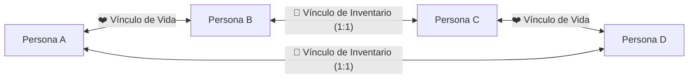

# Plan de Arquitectura v1: ChainLink Co-op Datapack (MC 26.2 / 26.3)

## 1. Objetivo General
Desarrollar un Datapack cooperativo para **Minecraft Java Edition 26.2 y 26.3** (`min_format: [107, 0]`, `max_format: [121, 0]`) diseñado para un equipo de **4 jugadores** (`Persona A`, `Persona B`, `Persona C`, `Persona D`) conectados en un ciclo cerrado de vida e inventario, con un sistema de **Hitos Dinámicos Aleatorios** que bloquea el acceso a la dimensión de **The End** hasta que el equipo cumpla la cuota de objetivos de la partida.

---

## 2. Topología de Vínculos Cruzados (El Anillo de 4 Jugadores)

### Reglas de Propagación y Reacción en Cadena
1. **Sincronización de Vida (A ↔ B y C ↔ D)**:
   - Ambos pares comparten sus puntos de salud en tiempo real.
   - Si **A** recibe daño, **B** recibe la misma reducción de vida instantáneamente (y viceversa).
   - Si **C** recibe daño, **D** recibe la misma reducción de vida instantáneamente (y viceversa).
2. **Sincronización de Inventario 1:1 (B ↔ C y D ↔ A)**:
   - El inventario completo (`hotbar.0..8`, `inventory.0..26`, `armor.head/chest/legs/feet`, `weapon.offhand`) está espejado en tiempo real entre **B y C**, y entre **D y A**.
   - Cuando cualquiera de los dos recoge, mueve, equipa o gasta un ítem, el cambio se replica inmediatamente en su compañero de inventario usando instantáneas NBT (`storage chainlink:sync`).
3. **Muerte y Penalización Cruzada (Sin Duplicación)**:
   - Con `minecraft:keep_inventory` en `false`:
   - **Caso 1: Muere A o B (ej. muere A por culpa de B o viceversa)**:
     - Al estar ligados en vida, **A y B mueren juntos**.
     - El jugador que muere suelta sus ítems una única vez al suelo, mientras que a **D** (ligado en inventario con A) y a **C** (ligado en inventario con B) **se les borra el inventario (`clear`)** y se limpian las instantáneas NBT del par.
     - Resultado: A y D pierden su inventario compartido; B y C pierden su inventario compartido, sin duplicar ítems en el suelo.
   - **Caso 2: Muere C o D (ej. muere C por culpa de D o viceversa)**:
     - Al estar ligados en vida, **C y D mueren juntos**.
     - A **B** (ligado en inventario con C) y a **A** (ligado en inventario con D) se les borra su inventario compartido.

---

## 3. Sistema de Hitos Dinámicos y Bloqueo del End
1. **Pool Expandible de 80 Hitos Pre-generados**:
   - Almacenado en `storage chainlink:milestones pool` y organizado por categorías:
     - **Jefes y Minijefes** (Warden, Wither, Elder Guardian, Evoker, Ravager, Breeze, Bogged, Piglin Brute...)
     - **Dimensiones y Estructuras** (Nether, Bastión, Fortaleza, Trial Chambers, Ancient City, End Stronghold...)
     - **Equipamiento y Progresión** (Full Diamante, Netherite, Elytras/Maza, Totems, Encantamientos, Pociones, Beacons...)
     - **Retos Cooperativos y Supervivencia** (Kills en equipo, comercio con aldeanos, domesticación, agricultura, redstone...)
2. **Selección Aleatoria por Partida**:
   - Al iniciar o mediante `/function chainlink:milestones/roll`, el datapack selecciona aleatoriamente $N$ hitos únicos (por defecto 10, configurable a 5, 10, 15, 20, 25 o cualquier número).
3. **Bloqueo Físico y Lógico del Portal del End**:
   - Mientras `#milestones_done < #milestones_req`:
     - Cualquier bloque `minecraft:end_portal` activado cerca de los jugadores es reemplazado inmediatamente por `minecraft:air` con efectos visuales y aviso en pantalla.
     - Si algún jugador entra a `minecraft:the_end` por cualquier medio antes de tiempo, es devuelto automáticamente al Overworld.
   - Al completar todos los hitos requeridos (`#end_unlocked = 1`), se desbloquea el Portal del End con una notificación global épica.
